<div align="center">

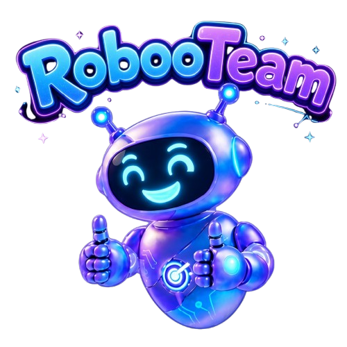

# RobooTeam

**Robótica, programação e inteligência artificial aprendidas na prática: trilha com leitura, quiz e minijogos, um robô para programar com blocos e partidas em equipe na Arena.**

<a href="https://tcc-roboo-team.vercel.app"></a>


</div>

<p align="center">
  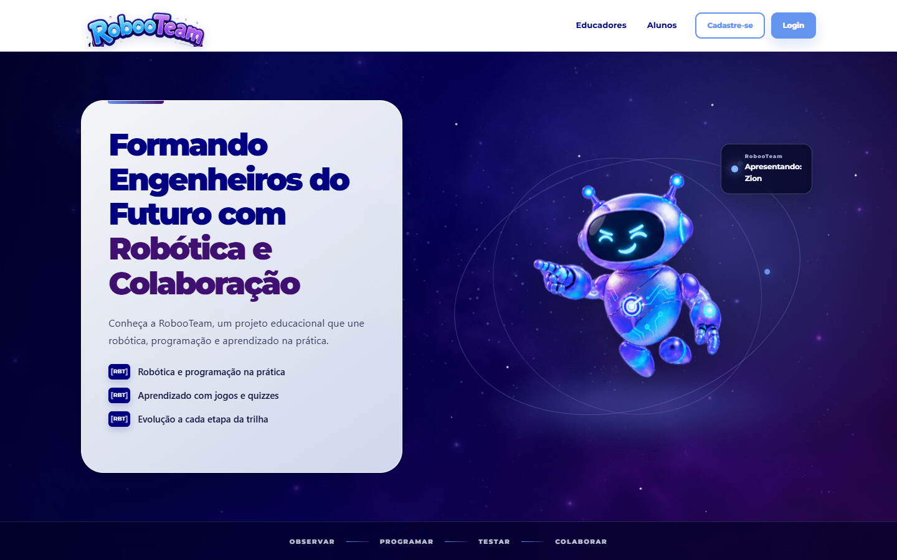
</p>

---

## 📑 Sumário

- [Sobre o projeto](#-sobre-o-projeto)
- [Área do aluno](#-área-do-aluno)
  - [Cadastro e login](#1-cadastro-e-login)
  - [Painel do aluno](#2-painel-do-aluno)
  - [Entrar na turma](#3-entrar-na-turma)
  - [Oficina do Robô](#4-oficina-do-robô)
  - [Trilha da IA: leitura, quiz e minijogos](#5-trilha-da-ia-leitura-quiz-e-minijogos)
  - [Missão Robô: programação em blocos](#6-missão-robô-programação-em-blocos)
  - [Arena RobooTeam](#7-arena-robooteam)
  - [No celular](#8-no-celular)
- [Painel da professora](#-painel-da-professora)
- [Página inicial e acesso](#-página-inicial-e-acesso)
- [Tecnologias](#️-tecnologias)
- [Como o sistema funciona](#-como-o-sistema-funciona)
- [Como executar no seu computador](#-como-executar-no-seu-computador)
- [Primeiro acesso](#-primeiro-acesso)
- [Trocar a senha da professora](#-trocar-a-senha-da-professora)
- [Banco de dados](#️-banco-de-dados)
- [Segurança](#-segurança)
- [Estrutura dos arquivos](#-estrutura-dos-arquivos)
- [Sobre as imagens deste README](#-sobre-as-imagens-deste-readme)
- [Equipe](#-equipe)

---

## 🤖 Sobre o projeto

A **RobooTeam** é uma plataforma educacional, desenvolvida como Trabalho de Conclusão de Curso, que apresenta a robótica, a programação e a inteligência artificial a crianças e adolescentes de um jeito leve e divertido. Em vez de aulas só teóricas, o aluno:

- avança por uma **trilha de aprendizado** em que cada etapa junta uma leitura curta, um **quiz com explicação** e um **minijogo**;
- personaliza o próprio **robô** na Oficina e acompanha seus **pontos e níveis**;
- treina lógica de programação na **Missão Robô**, levando o robô até a bandeira com blocos de comando;
- joga **partidas em equipe na Arena**, em sala de aula, com ranking ao vivo e pedidos de ajuda para os colegas ou para a professora.

A professora acompanha tudo por um **painel próprio**: vê o progresso de cada aluno, gera o código da turma, monta a trilha do jeito que quiser e cria e acompanha as partidas da Arena.

O objetivo é estimular a curiosidade, o raciocínio lógico e a colaboração entre os alunos.

| 🗺️ Trilha padrão | ❓ Quiz | 🎮 Minijogos | 🧱 Missão Robô | 🎨 Oficina do Robô | 🏆 Arena |
| :---: | :---: | :---: | :---: | :---: | :---: |
| 5 etapas | 20 perguntas com explicação | 5 tipos | 5 fases | 216 combinações de pose, cor e acessório | Mapas de 6×6 a 10×10, até 12 equipes de 4 alunos |

---

## 👦 Área do aluno

O caminho do aluno dentro da plataforma:

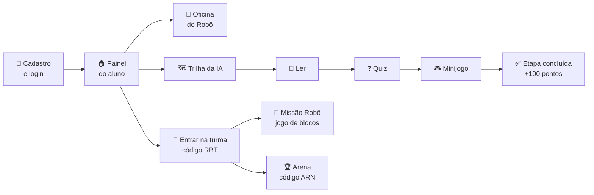

### 1. Cadastro e login

<table>
  <tr>
    <td width="48%" align="center">
      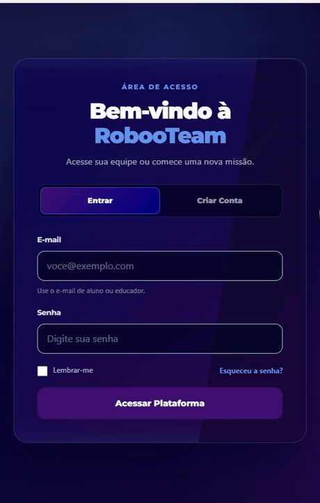
    </td>
    <td width="52%">

O aluno cria a conta pelo botão **Cadastre-se** da página inicial (aba **Criar Conta**):

- **Nome completo:** de 3 a 100 caracteres.
- **E-mail:** até 254 caracteres (não pode repetir um e-mail já cadastrado).
- **Senha:** de 8 a 20 caracteres, digitada duas vezes.
- É preciso aceitar os **Termos de Serviço** e a **Política de Privacidade**.

Depois do cadastro, o site volta sozinho para a aba **Entrar**, com o e-mail já preenchido. Basta digitar a senha e clicar em **Acessar Plataforma**.

- **Lembrar-me** mantém o login por até 30 dias. Sem essa opção, o login vale até o navegador ser fechado.
- Todo cadastro feito pelo site é de **aluno**. A conta da professora já vem criada no banco de dados.
- O login leva cada pessoa para o seu painel: o do aluno ou o da professora.

</td>
  </tr>
</table>

### 2. Painel do aluno

<p align="center">
  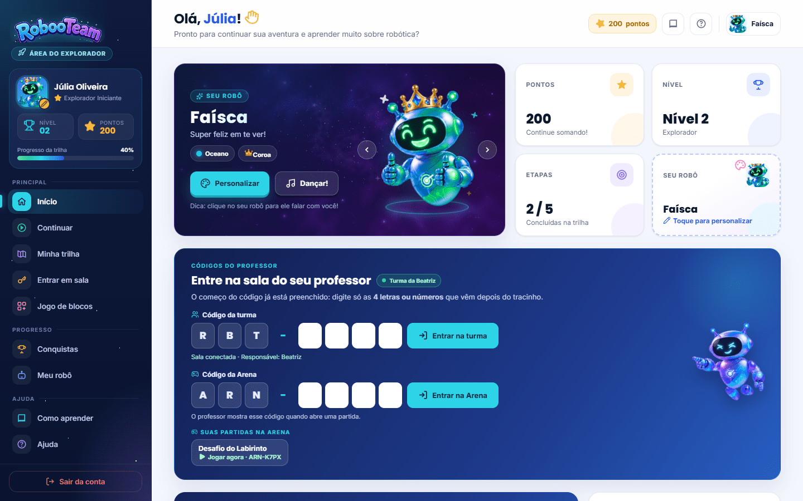
</p>

O painel é a "base" do explorador. Tudo é atualizado com o progresso salvo no servidor:

| Parte do painel | O que mostra |
| --- | --- |
| **Barra lateral** | Robô do aluno, nome, **nível**, **pontos** e a barra de **progresso da trilha**. Menu com Início, Continuar, Minha trilha, Entrar em sala, Jogo de blocos, Conquistas, Meu robô, Como aprender e Ajuda. No celular ela vira uma gaveta. |
| **Cabeçalho** | Saudação com o primeiro nome ("Olá, Júlia!"), total de pontos, atalhos para as ajudas e o robô do aluno. |
| **Seu robô** | O robô personalizado em destaque, flutuando. Clicando nele, ele fala frases divertidas; as setas trocam a pose; **Dançar!** faz ele dançar com confete; **Personalizar** abre a Oficina. |
| **Cards** | **Pontos**, **Nível**, **Etapas** concluídas na trilha e um atalho para a Oficina do Robô. |
| **Códigos do professor** | Os campos **Código da turma** (`RBT-`) e **Código da Arena** (`ARN-`), além dos atalhos para as partidas da Arena em que o aluno já entrou. |
| **Missão atual** | A próxima etapa da trilha, com o botão **Continuar Etapa**, e a **Dica do Robô**. |
| **Trilha** | A linha do tempo da trilha "Conhecendo a Inteligência Artificial", com a porcentagem concluída. |

<p align="center">
  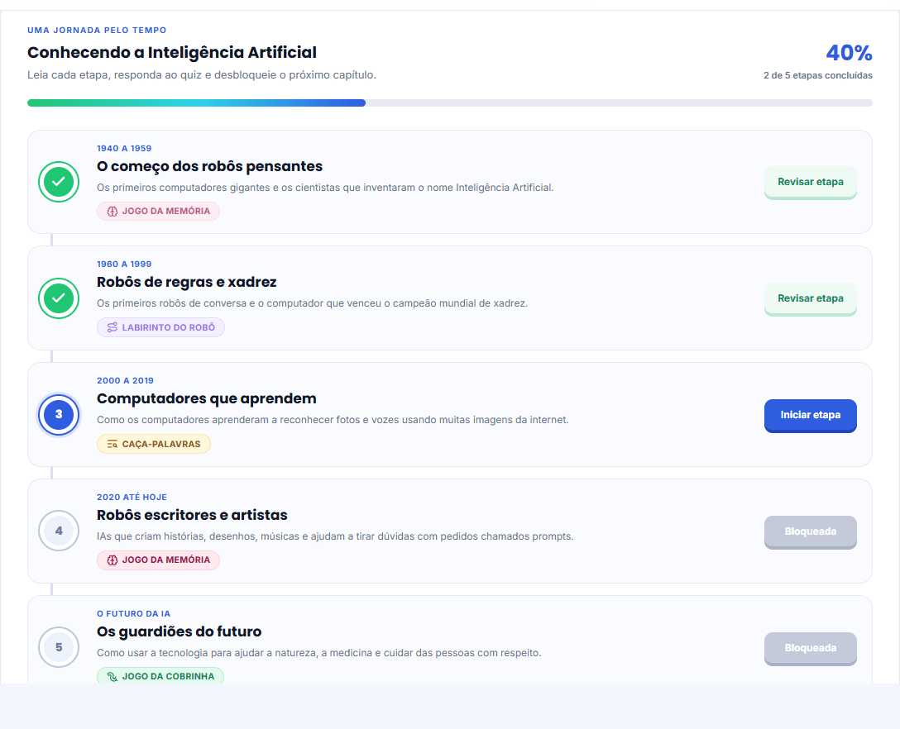
</p>

Na linha do tempo, cada etapa mostra o período, o tema e o minijogo. As etapas aparecem em três estados:

- ✅ **Concluída:** botão **Revisar etapa** (dá para reler e jogar de novo quando quiser).
- 🔵 **Atual:** botão **Iniciar etapa**.
- 🔒 **Bloqueada:** libera quando a etapa anterior for concluída.

Os botões **Como aprender** e **Ajuda** abrem um passo a passo e uma central com as dúvidas mais comuns:

<table>
  <tr>
    <td align="center" width="50%">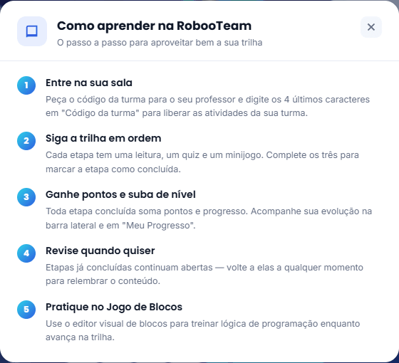<br><sub><b>Como aprender:</b> o passo a passo da plataforma</sub></td>
    <td align="center" width="50%">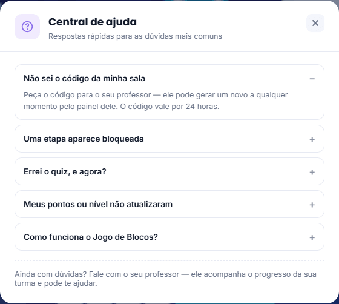<br><sub><b>Central de ajuda:</b> respostas rápidas para as dúvidas comuns</sub></td>
  </tr>
</table>

#### ⭐ Pontos e níveis

| Como ganhar pontos | Quanto vale |
| --- | --- |
| Concluir uma etapa da trilha | **100 pontos** |
| Subir de nível | O nível sobe **a cada 2 etapas** concluídas (0–1 etapa: nível 1 · 2–3: nível 2 · 4–5: nível 3) |
| Progresso da trilha | Porcentagem de etapas concluídas (aparece na barra lateral e na trilha) |

### 3. Entrar na turma

<p align="center">
  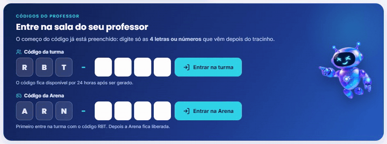
</p>

A professora gera um código **`RBT-XXXX`** no painel dela (válido por **24 horas**) e passa para a turma. No painel do aluno:

1. O começo do código (`RBT-`) e o tracinho **já vêm preenchidos**: o aluno digita só os **4 últimos caracteres**, que aparecem em quadradinhos.
2. Se faltar algum caractere, o campo treme e avisa quantos faltam (como no GIF: *"Faltam 2 caracteres do código."*).
3. Também dá para colar o código inteiro (`rbt-7a3f`, `RBT7A3F`...): o campo entende. Se o aluno digitar um código de Arena no campo da turma (ou o contrário), o site avisa qual campo usar.
4. Com o código certo, aparece **"Entrada na sala realizada com sucesso!"** e o selo com o nome da turma.

**O que muda depois de entrar na turma:**

- o aluno passa a ver a **trilha montada pela professora** (se ela personalizou a trilha);
- o **jogo de blocos (Missão Robô)** é liberado;
- o campo **Código da Arena** passa a funcionar (só joga na Arena quem está na turma da professora);
- o progresso do aluno aparece no **painel da professora**.

### 4. Oficina do Robô

<p align="center">
  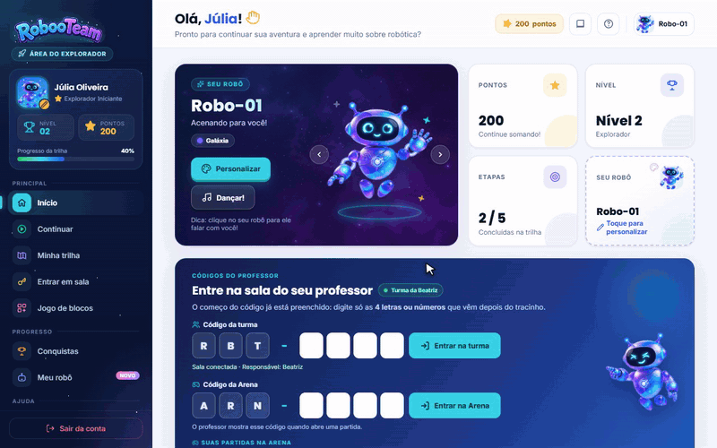
</p>

Na **Oficina do Robô** (botão **Personalizar**, card **Seu robô** ou item **Meu robô** do menu), o aluno cria o seu companheiro:

| Opção | Escolhas |
| --- | --- |
| **Nome** | Até 16 letras (o padrão é `Robo-01`) |
| **Pose e humor** | Oi!, Feliz, Aventura, Zen, Pensativo e Focado |
| **Cor** | Galáxia, Chiclete, Foguete, Sol, Floresta e Oceano |
| **Acessório** | Nenhum, Coroa, Cartola, Laço, Capelo e Boné |

<table>
  <tr>
    <td width="50%"></td>
    <td width="50%">

- O botão **Surpresa!** sorteia pose, cor e acessório.
- A prévia muda na hora; **Salvar meu robô** aplica o visual no painel inteiro (barra lateral, cabeçalho, destaque e card) com confete.
- Clique no robô para ele falar, use as setas para trocar a pose e o botão **Dançar!** para ver o passinho.
- O mesmo robô aparece na **Arena**: no tabuleiro, no lobby e na comemoração da vitória.
- A escolha fica salva **no navegador** do aluno.

</td>
  </tr>
</table>

> Cada pose tem uma imagem do robô já vestindo cada acessório (`img/1_variantes/1_coroa.webp`...). A cor é aplicada por filtro de matiz, e as partes douradas e rosas (coroa, laço, capelo) ficam numa camada separada (`*_cor.webp`), para a coroa continuar dourada num robô verde.

### 5. Trilha da IA: leitura, quiz e minijogos

A trilha padrão se chama **"Conhecendo a inteligência artificial"** e é uma viagem no tempo, da origem dos computadores ao futuro da IA:

| Etapa | Período | Tema | Minijogo |
| :---: | --- | --- | --- |
| 1 | 1940 a 1959 | O começo dos robôs pensantes | 🧠 Jogo da memória |
| 2 | 1960 a 1999 | Robôs de regras e xadrez | 🧭 Labirinto do robô |
| 3 | 2000 a 2019 | Computadores que aprendem | 🔤 Caça-palavras |
| 4 | 2020 até hoje | Robôs escritores e artistas | 🧠 Jogo da memória |
| 5 | O futuro da IA | Os guardiões do futuro | 🐍 Jogo da cobrinha |

Cada etapa tem **4 blocos de leitura**, **4 perguntas** e **1 minijogo**. Para concluir, o aluno precisa **acertar todas as perguntas** e **vencer o minijogo**. As etapas são liberadas em ordem, e as concluídas podem ser revistas a qualquer momento.

#### 📖 Leitura

<p align="center">
  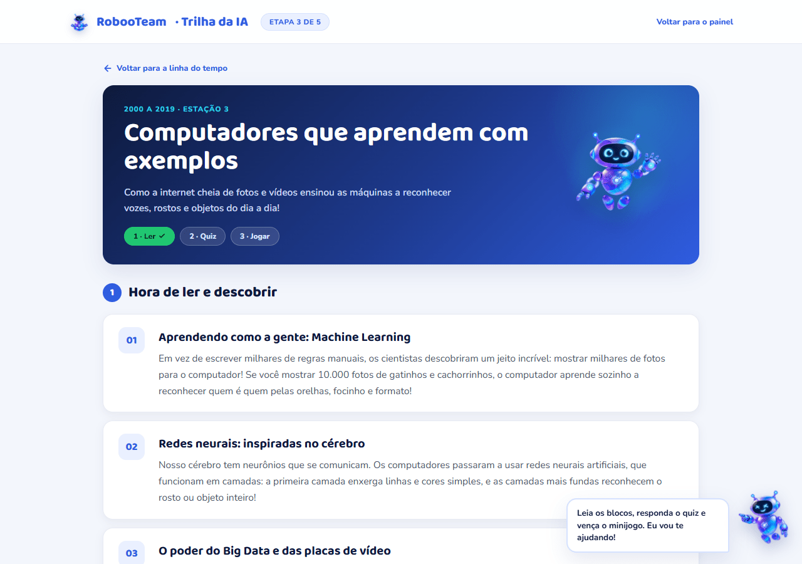
</p>

No topo, os passos **1 · Ler**, **2 · Quiz** e **3 · Jogar** ficam verdes conforme o aluno avança. Os textos são curtos, numerados e escritos para crianças. A professora pode incluir imagens nos blocos de leitura.

#### ❓ Quiz com explicação

<p align="center">
  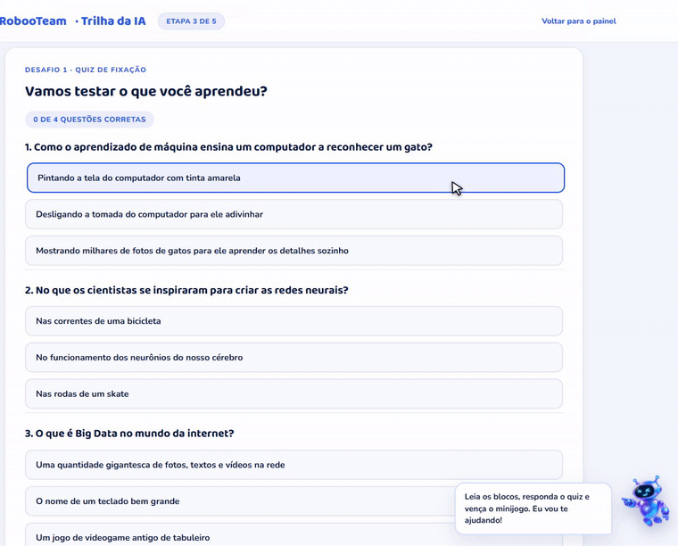
</p>

- Ao escolher uma alternativa, a resposta já é corrigida: **verde** para o acerto, **vermelho** para o erro.
- Sempre aparece a **explicação**, e o aluno pode tentar de novo quantas vezes precisar, sem perder pontos.
- O **mascote companheiro**, no canto da tela, comemora os acertos, consola nos erros e dá dicas quando é clicado. Também há efeitos sonoros e confete.
- O contador mostra quantas perguntas já estão certas (ex.: *"1 de 4 questões corretas"*).

#### 🎮 Minijogos

Os minijogos são feitos com HTML, CSS e `<canvas>`, funcionam com mouse, teclado e toque, e comemoram a vitória com confete:

<table>
  <tr>
    <td align="center" width="50%">
      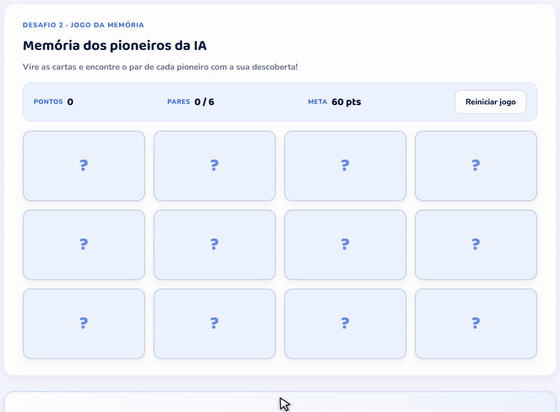<br>
      <b>🧠 Jogo da memória</b><br>
      <sub>Encontrar os pares de termo e significado. Cada par vale 10 pontos, e as cartas mostram o número do par.</sub>
    </td>
    <td align="center" width="50%">
      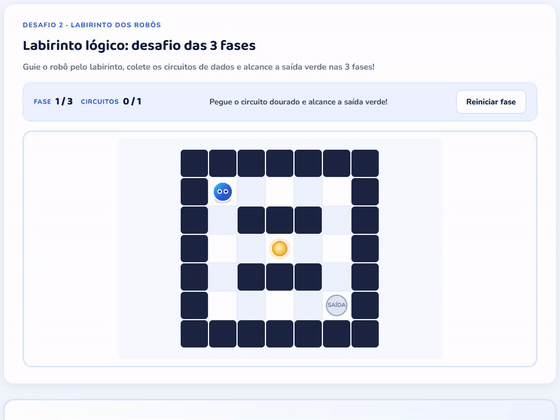<br>
      <b>🧭 Labirinto do robô</b><br>
      <sub>Guiar o robô com as setas (ou WASD), pegar os circuitos dourados e chegar à saída verde. São até 3 fases.</sub>
    </td>
  </tr>
  <tr>
    <td align="center" width="50%">
      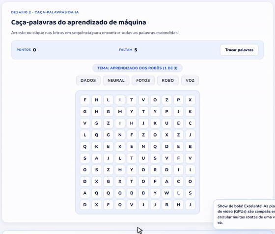<br>
      <b>🔤 Caça-palavras</b><br>
      <sub>Arrastar sobre as letras (ou clicar na primeira e na última). A grade é sorteada a cada partida, em 8 direções, e há 3 grupos de palavras.</sub>
    </td>
    <td align="center" width="50%">
      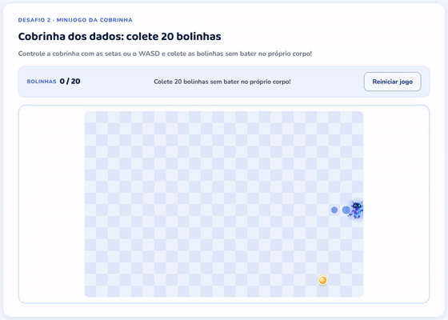<br>
      <b>🐍 Jogo da cobrinha</b><br>
      <sub>O mascote é a cabeça da cobrinha. Pegar a quantidade de bolinhas da meta (20 na trilha padrão) sem bater no próprio corpo.</sub>
    </td>
  </tr>
  <tr>
    <td align="center" width="50%">
      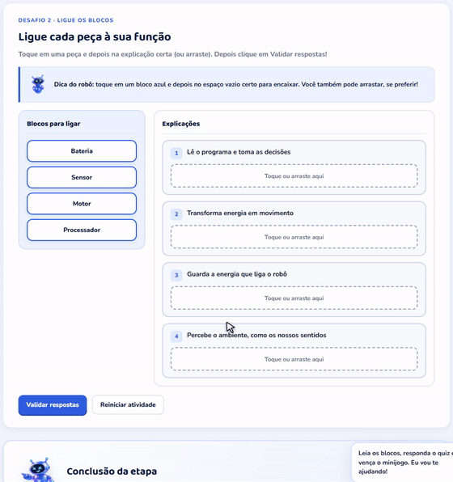<br>
      <b>🧩 Ligar os blocos</b><br>
      <sub>Tocar em um bloco e depois na explicação certa (ou arrastar). <b>Validar respostas</b> mostra em verde o que está certo e em vermelho o que está trocado.</sub>
    </td>
    <td width="50%">

**Todos os minijogos podem ser escolhidos pela professora** no editor da trilha.

O **Ligar os blocos** não está na trilha padrão: no GIF ao lado, ele aparece numa **etapa bônus criada pela professora** ("As peças de um robô"), mostrando como uma etapa nova chega aos alunos da turma.

A professora também configura cada jogo: os pares da memória e do ligar blocos, os grupos de palavras do caça-palavras, a meta de bolinhas da cobrinha e a quantidade de fases do labirinto.

</td>
  </tr>
</table>

#### ✅ Conclusão da etapa

<p align="center">
  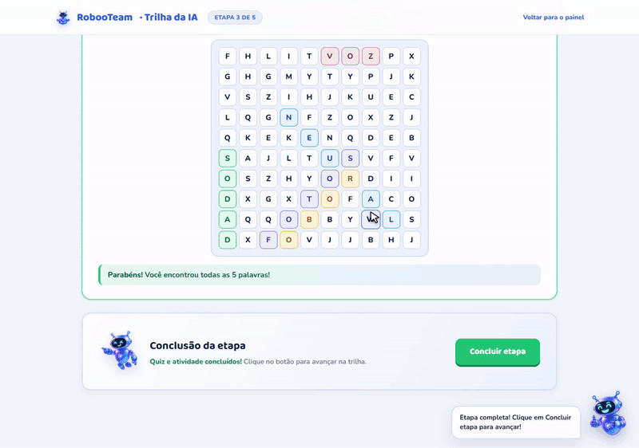
</p>

Com o quiz e o minijogo completos, o botão **Concluir etapa** é liberado. O progresso é **conferido e salvo no servidor**, o aluno volta para a trilha e o painel já mostra os novos pontos, o nível e a próxima etapa desbloqueada.

### 6. Missão Robô: programação em blocos

<p align="center">
  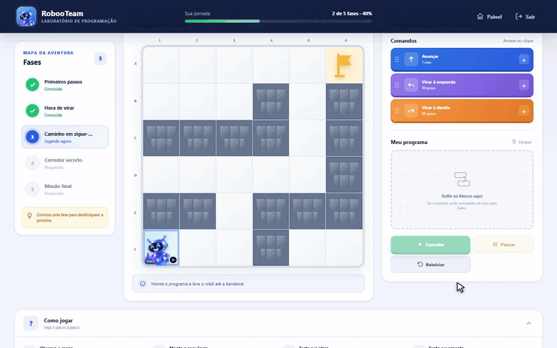
</p>

Jogo de lógica com **5 fases** em um mapa **6×6**. O aluno monta uma sequência de comandos para levar o robô até a bandeira **sem bater nas paredes, sem sair do mapa e sem passar do limite de blocos**. O jogo é liberado depois que o aluno entra em uma turma.

| Fase | Nome | Desafio | Limite de blocos |
| :---: | --- | --- | :---: |
| 1 | Primeiros passos | Levar o robô em linha reta até a bandeira | 3 |
| 2 | Hora de virar | Fazer uma curva sem tocar nas paredes | 7 |
| 3 | Caminho em zigue-zague | Combinar avanços e curvas para atravessar o corredor | 15 |
| 4 | Corredor secreto | Atravessar o labirinto pelo menor caminho | 16 |
| 5 | Missão final | Usar tudo o que aprendeu no maior labirinto | 24 |

<p align="center">
  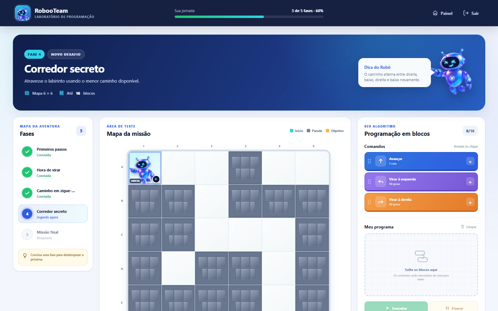
</p>

- **Comandos:** **Avançar** (1 casa), **Virar à esquerda** e **Virar à direita** (90°). Basta clicar ou arrastar; os blocos do programa podem ser reordenados (arrastando) e removidos.
- **Executar** roda o programa bloco por bloco, destacando o bloco atual e pintando o caminho do robô. Também há **Pausar**, **Reiniciar** e **Limpar**.
- Se o robô bater numa parede ou sair do mapa, o bloco do erro fica vermelho e a mensagem explica o que aconteceu.
- **Pontuação:** cada fase vencida vale **100 pontos + 10 por bloco que sobrar** do limite. Fica salva a melhor pontuação de cada fase.
- No final aparece a janela **"Missão cumprida!"**, com os blocos usados, as estrelas de desempenho (quanto menos blocos, mais estrelas) e o botão **Próxima fase**.
- O servidor **simula o programa de novo** antes de salvar, então não dá para "pular" fases.

### 7. Arena RobooTeam

A Arena é uma **partida em sala de aula**: a professora cria um mapa e mostra um código **`ARN-XXXX`**; os alunos da turma entram, formam equipes e programam o robô para chegar à bandeira no menor tempo.

#### 🚀 Entrar na partida e montar a equipe

<p align="center">
  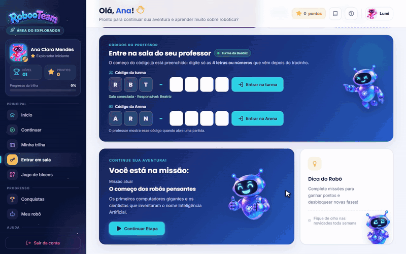
</p>

1. No painel, o aluno digita os 4 últimos caracteres no campo **Código da Arena** (o `ARN-` já vem preenchido). Só entra quem já está na **turma da professora** (código `RBT`).
2. No lobby, ele entra numa **equipe existente** (até **4 jogadores** por equipe) ou **cria uma nova**, escolhendo nome, mascote e cor. A arena aceita até 12 equipes.
3. Na sala de espera aparecem os colegas da equipe, as outras equipes e dicas rotativas, além do botão **Aprender a jogar**.
4. Quando a professora clica em **Iniciar partida**, todos veem a contagem **3, 2, 1, Já!** e o jogo começa.

#### 🧠 Programar o robô e chegar à bandeira

<p align="center">
  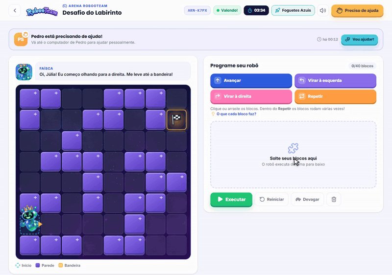
</p>

<table>
  <tr>
    <td width="40%" align="center">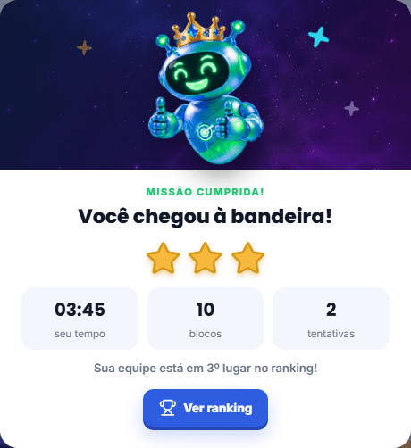</td>
    <td width="60%">

- **Blocos:** **Avançar**, **Virar à esquerda**, **Virar à direita** e **Repetir**. O **Repetir** roda os blocos de dentro dele de **1 a 10 vezes** (botões **−** e **+**) e economiza blocos.
- Limite de **40 blocos**, ou o limite definido pela professora.
- O robô do tabuleiro é o **robô personalizado** do aluno, com uma setinha mostrando para onde ele olha. Há velocidade **Devagar/Rápido** e botão de som.
- O **cronômetro** de cada aluno começa na largada (ou quando ele entra, se chegar depois).
- Ao chegar à bandeira, a janela **"Missão cumprida!"** mostra o tempo, os blocos, as tentativas, as estrelas e a posição da equipe. Depois disso o aluno pode continuar no **modo treino**, tentando usar menos blocos.

| Estrelas | Como ganhar |
| --- | --- |
| ⭐⭐⭐ | Chegar em até 2 tentativas, sem dica do mapa |
| ⭐⭐ | Chegar em até 5 tentativas, com no máximo 1 dica |
| ⭐ | Chegar à bandeira do seu jeito |

</td>
  </tr>
</table>

O **ranking ao vivo** soma o tempo de cada jogador da equipe: fica na frente a equipe com **mais pessoas na bandeira** e, no empate, a de **menor tempo total**. No card da equipe, o aluno vê quem já chegou (com tempo e estrelas), quem está programando, quem está online e quem pediu ajuda.

#### 🙋 Pedir ajuda

<p align="center">
  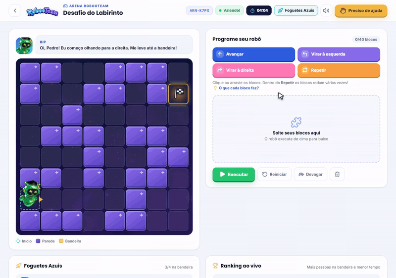
</p>

Se travar, o aluno toca em **Preciso de ajuda** e escolhe:

- **Dicas do robô:** um guia com **A missão** (como a fase funciona), **Os blocos** (o que cada bloco faz, com animações), **Pense como o robô** (truques de lógica) e **Dica do mapa**, que revela o caminho aos poucos, em 3 níveis. Cada dica do mapa pode diminuir as estrelas.
- **Chamar minha equipe:** os colegas veem o aviso *"Fulano está precisando de ajuda!"* e o botão **Vou ajudar!**, e vão até o computador dele.
- **Chamar o professor:** o aluno escolhe a dúvida (*Não sei por onde começar*, *Meu robô bate na parede*, *Não entendi o bloco Repetir* ou *Tenho outra dúvida*) e entra na fila do painel da professora.

Todo pedido tem **30 segundos de chamada**, mostrados num anel de contagem. Se a equipe não resolver nesse tempo, aparece **"A equipe toda está com dúvida?"**, com o botão para chamar a professora. A ajuda é **presencial**: quem vai ajudar se levanta e vai até o colega.

#### 🏁 Fim da partida

<p align="center">
  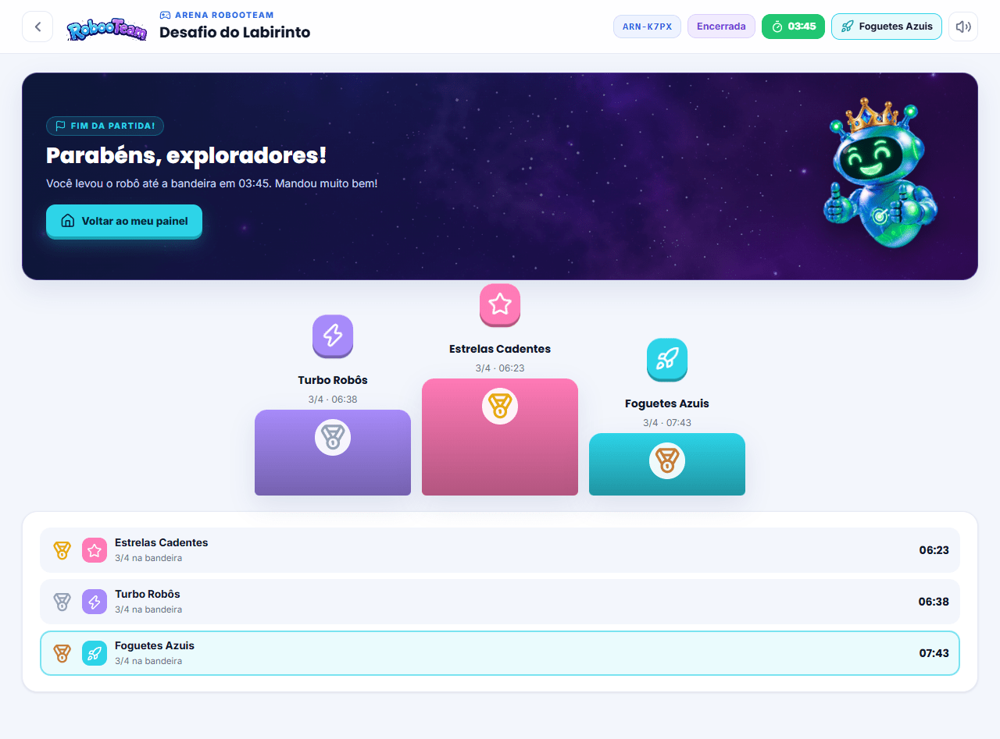
</p>

Quando a professora encerra a partida, todos veem o **pódio** com as três primeiras equipes e o ranking final.

### 8. No celular

Todas as telas são responsivas: no celular, o menu do aluno vira uma gaveta, os minijogos ganham setas na tela e o tabuleiro aparece antes dos blocos.

<p align="center">
  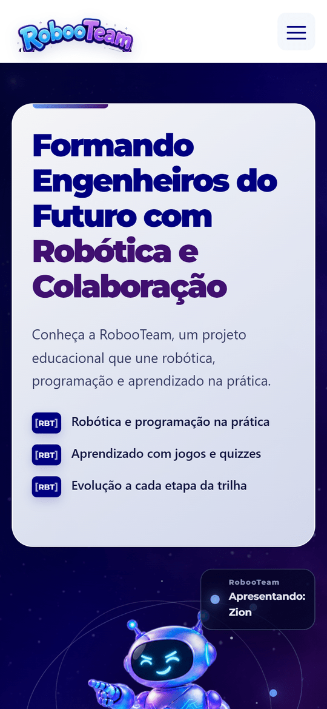
  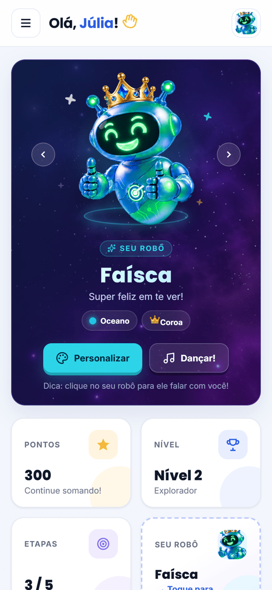
  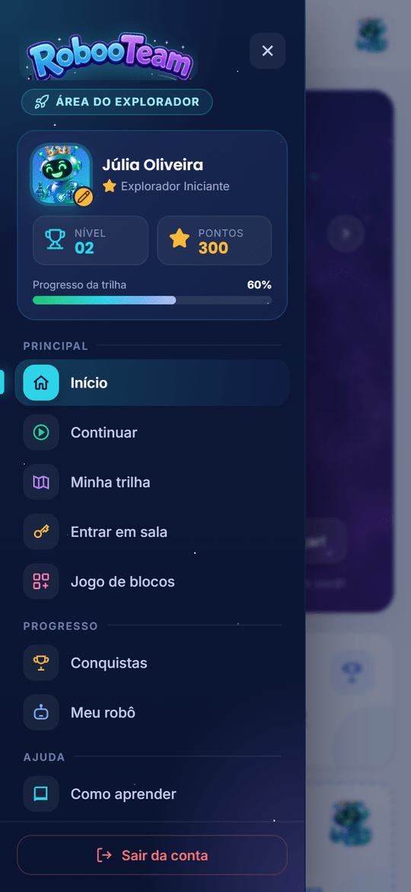
  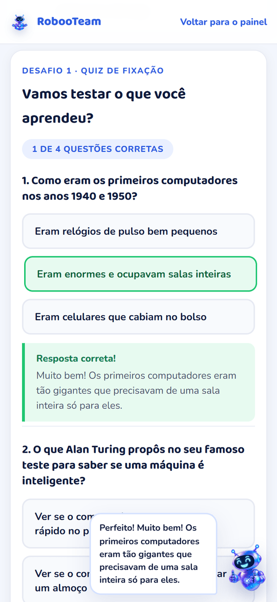
  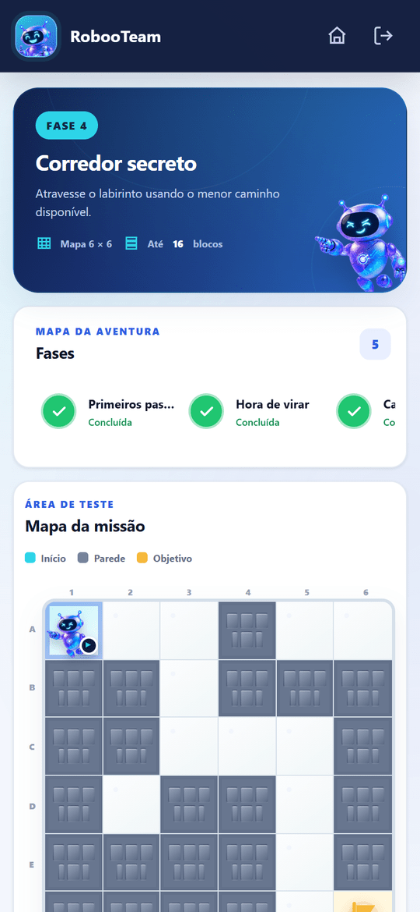
</p>

---

## 👩‍🏫 Painel da professora

<p align="center">
  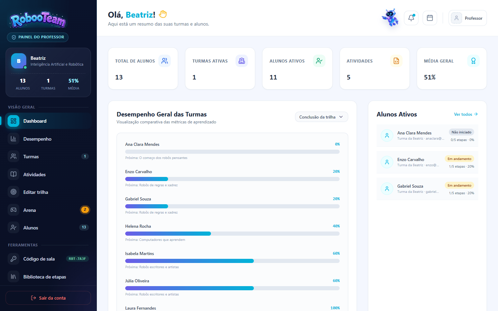
</p>

| Recurso | O que a professora faz |
| --- | --- |
| **Indicadores** | Total de alunos, turmas ativas, alunos ativos (que já começaram a trilha), quantidade de atividades e média geral de progresso. |
| **Desempenho** | Barra de progresso de cada aluno na trilha, com a próxima etapa dele. |
| **Alunos ativos e atividades recentes** | Uma prévia dos alunos da turma, com situação e progresso, e a tabela com as últimas atualizações de progresso de cada aluno. |
| **Código de sala** | Gera o código `RBT-XXXX` (válido por 24 horas) e copia com um clique. |
| **Buscar alunos** | Filtra por nome, e-mail, turma e situação (*Não iniciado*, *Em andamento*, *Concluído*). **Ver detalhes** mostra as etapas concluídas e a próxima etapa do aluno. |
| **Editar trilha** | Cria, edita, reordena e remove etapas, escolhe o minijogo e restaura a trilha original. |
| **Arena** | Cria partidas, desenha ou sorteia o mapa, acompanha tudo ao vivo e atende os pedidos de ajuda. |

### Turma e código de sala

<table>
  <tr>
    <td width="36%" align="center">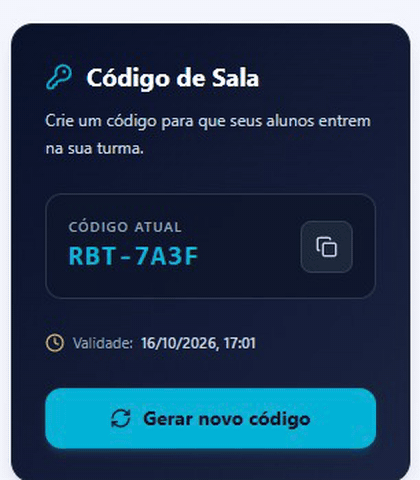</td>
    <td width="64%">
      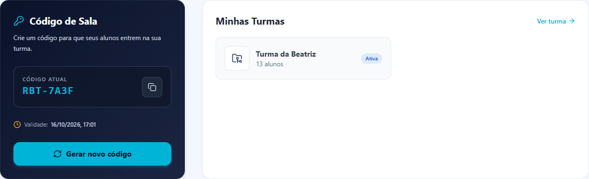
      <p>O botão <b>Gerar novo código</b> cria um código novo (o anterior deixa de valer) com validade de 24 horas. O código também aparece na barra lateral do painel.</p>
    </td>
  </tr>
</table>

<details>
<summary><b>Ver a busca e a lista de alunos</b></summary>
<br>
<p align="center">
  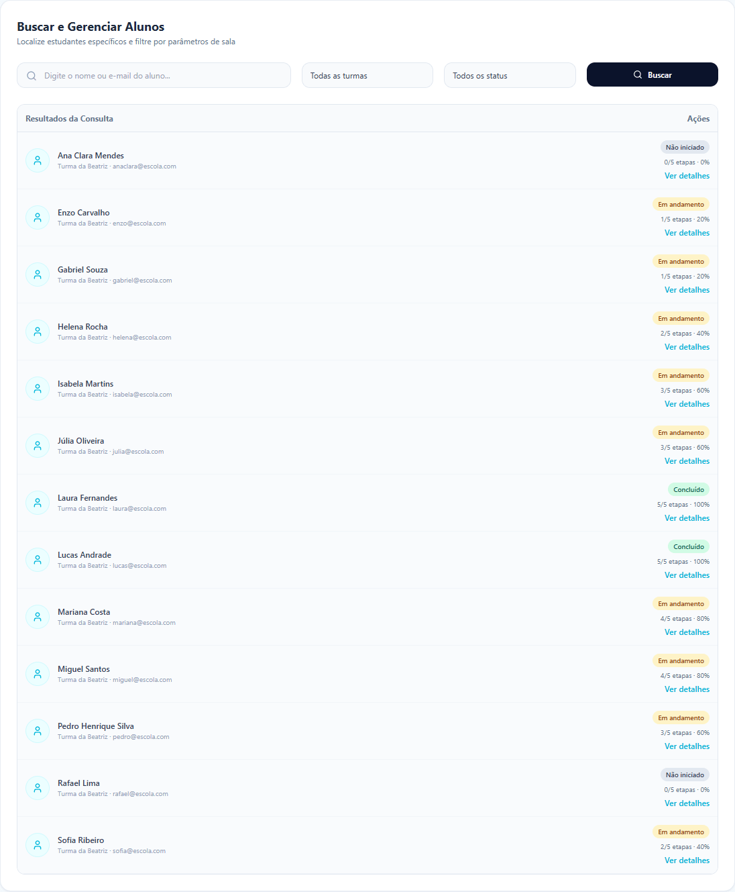
</p>
</details>

### Editor da trilha

<p align="center">
  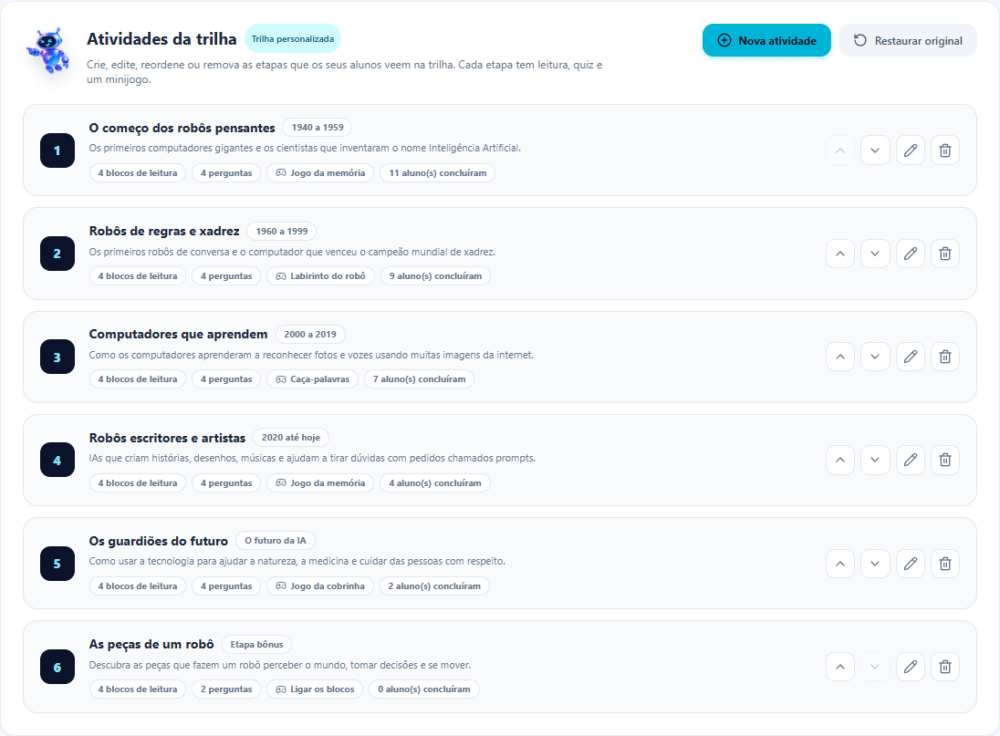
</p>

<p align="center">
  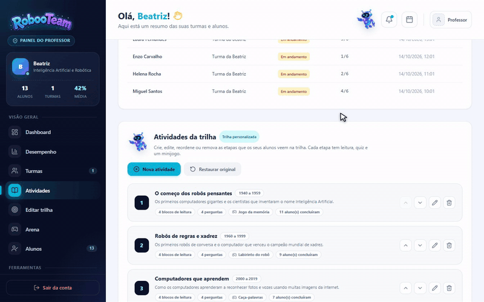
</p>

Quando a professora altera qualquer etapa, a trilha da turma vira uma **trilha personalizada** (selo no topo da lista), e todos os alunos da turma passam a vê-la. Quem ainda não entrou em nenhuma turma continua vendo a trilha padrão. O botão **Restaurar original** volta à trilha padrão.

| Parte do formulário | O que dá para configurar |
| --- | --- |
| **Card da trilha** | Título, período, descrição curta e cor do card |
| **Página da aula** | Chamada do topo, título e introdução |
| **Blocos de leitura** | De 1 a 8 blocos, cada um com título, texto e imagem opcional (PNG, JPG, WEBP ou GIF de até 4 MB) |
| **Quiz** | De 1 a 10 perguntas, com 2 a 5 alternativas, a resposta certa e a explicação |
| **Minijogo** | Memória ou ligar blocos (3 a 8 pares), caça-palavras (até 5 grupos de 3 a 8 palavras), cobrinha (meta de 5 a 60 bolinhas), labirinto (1 a 3 fases) ou "somente leitura e quiz" |

### Arena: criar, acompanhar e ajudar

<p align="center">
  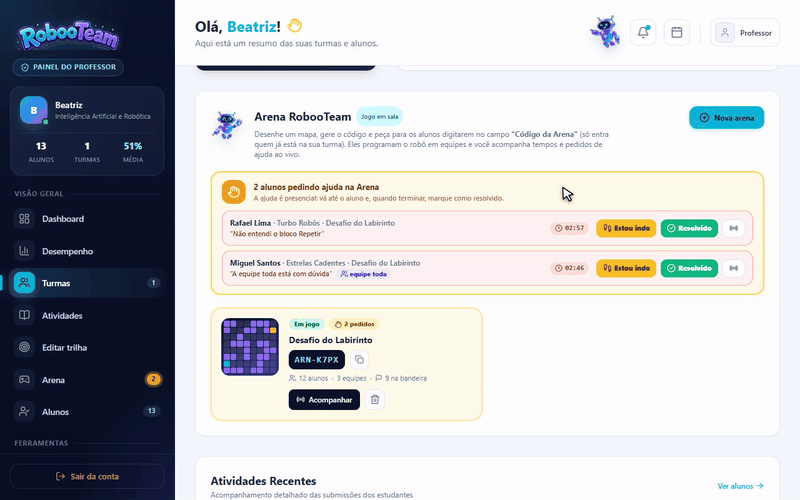
</p>

- **Nova arena:** nome, tamanho do mapa (**6×6** iniciante, **8×8** médio ou **10×10** desafio), direção inicial do robô e limite de blocos opcional.
- O mapa é pintado com as ferramentas **Caminho**, **Parede**, **Início** e **Bandeira**, ou **sorteado** com um clique. O editor só deixa salvar se existir caminho até a bandeira e mostra o **caminho mais curto** e o mínimo de comandos.
- Ao salvar, a arena recebe o código **`ARN-XXXX`** para mostrar à turma.

<p align="center">
  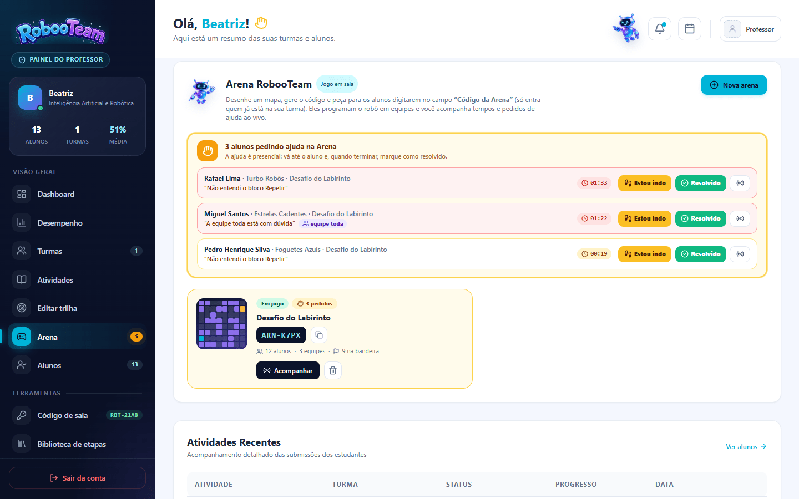
</p>

A **fila de ajuda** junta os pedidos de todas as arenas, com o motivo, a equipe e o tempo de espera. Os pedidos sem resposta há mais de **30 segundos** ficam em destaque, tocam um aviso e mostram um alerta. O botão **Estou indo** mostra ao aluno que a professora está a caminho, e **Resolvido** encerra o pedido.

<p align="center">
  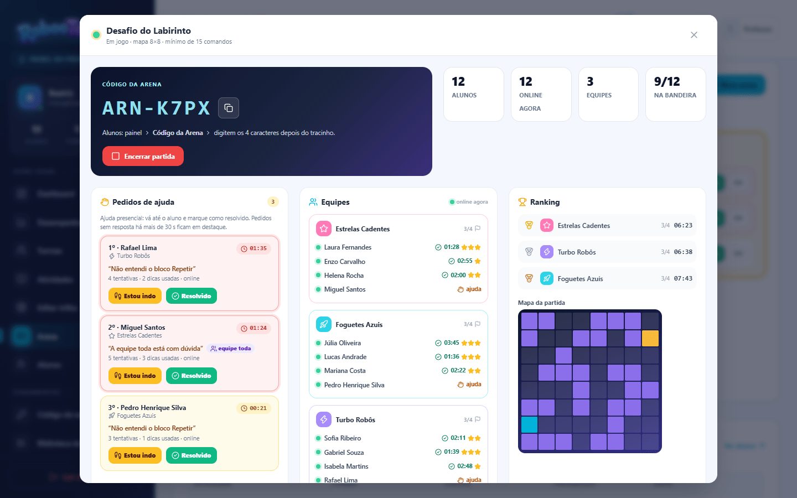
</p>

<p align="center">
  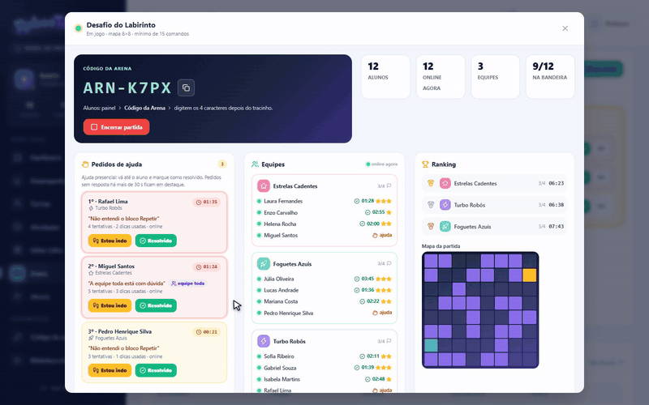
</p>

Em **Acompanhar**, a professora vê a partida ao vivo: alunos, quem está online, quantos chegaram à bandeira, a fila de ajuda, as equipes com o tempo e as estrelas de cada aluno, o ranking e o mapa. Dali ela **inicia**, **encerra**, **reabre** ou começa uma **nova rodada** (zerando os tempos).

---

## 🌐 Página inicial e acesso

A página inicial apresenta o projeto, com animações que acompanham a rolagem: a placa de circuito "acende" módulo por módulo e um foguete decola pela jornada de aprendizado.

<table>
  <tr>
    <td align="center" width="33%">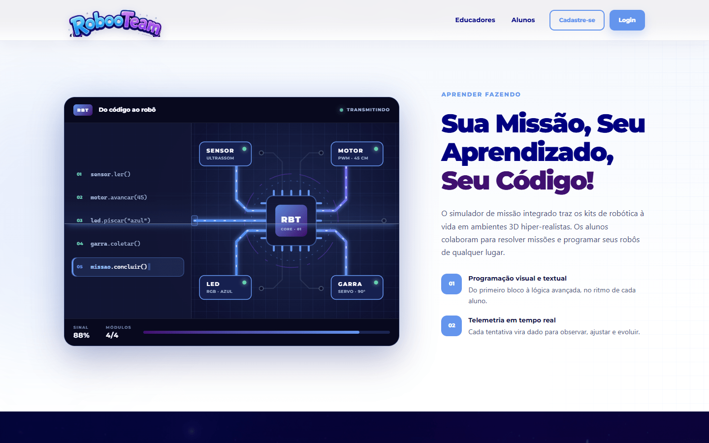<br><sub>Do código ao robô</sub></td>
    <td align="center" width="33%">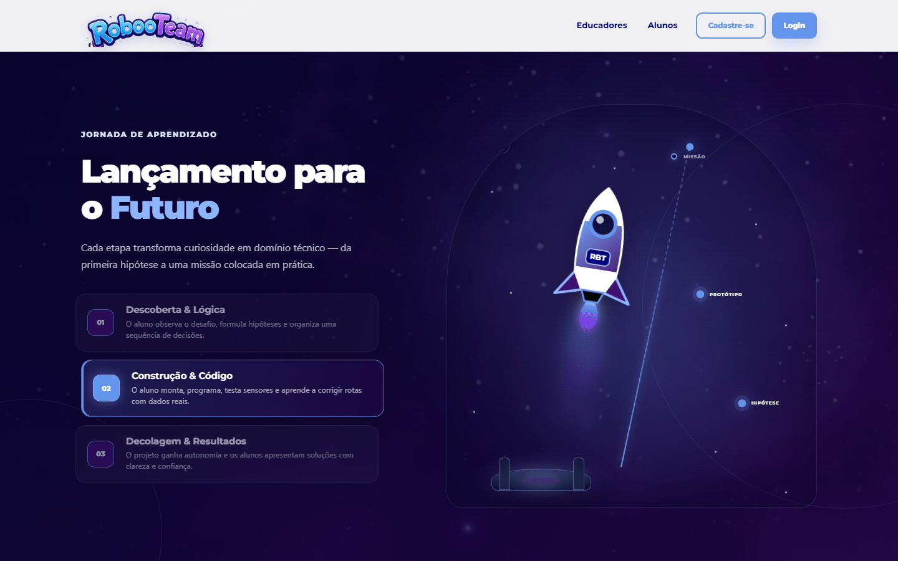<br><sub>Jornada de aprendizado</sub></td>
    <td align="center" width="33%">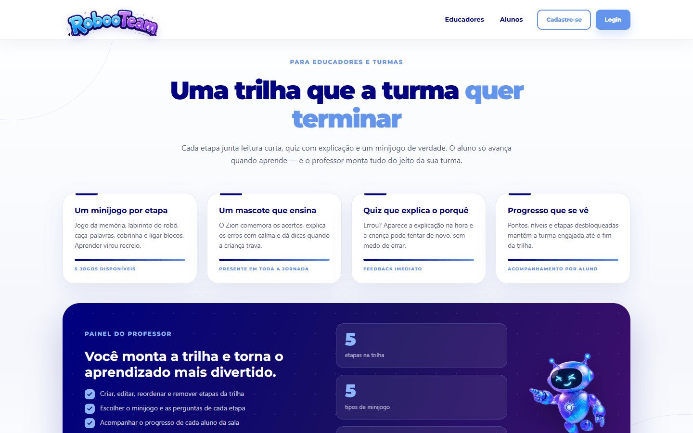<br><sub>Para educadores e turmas</sub></td>
  </tr>
</table>

<p align="center">
  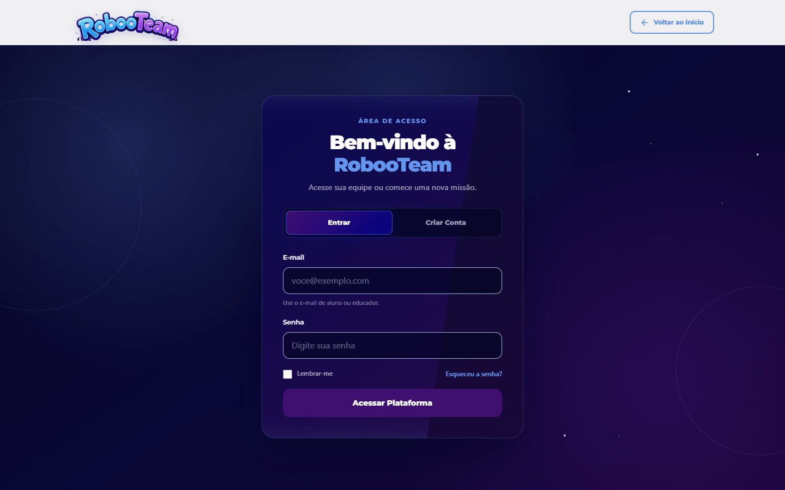
</p>

---

## 🛠️ Tecnologias

<p align="center">
  
</p>

| Tecnologia | Para que é usada |
| --- | --- |
| **Python 3.12** | Linguagem do servidor |
| **Flask** | Páginas, rotas e API do sistema |
| **Jinja2** | Montagem das páginas HTML no servidor |
| **HTML, CSS e JavaScript** | Interface, animações e minijogos, sem frameworks de JavaScript |
| **Canvas API** | Desenho do labirinto, da cobrinha e do confete |
| **Web Audio API** | Efeitos sonoros dos acertos, erros e vitórias |
| **Tailwind CSS (CDN) e Lucide** | Estilos e ícones do painel da professora (os outros ícones vêm de um sprite SVG baseado no Lucide, em `templates/_icones.html`) |
| **Google Fonts** | Fontes Montserrat, Poppins, Inter, Baloo 2 e Nunito |
| **PostgreSQL (Supabase)** | Banco de dados: usuários, progresso, trilhas e arenas |
| **Supabase Storage** | Armazenamento das imagens enviadas para as trilhas |
| **psycopg 3** | Conexão do Python com o PostgreSQL (com pool de conexões) |
| **Werkzeug** | Criptografia (hash) das senhas |
| **ItsDangerous** | Tokens de login assinados |
| **Vercel** | Hospedagem do site (região São Paulo) |
| **Git e GitHub** | Controle de versão |

---

## 🔄 Como o sistema funciona

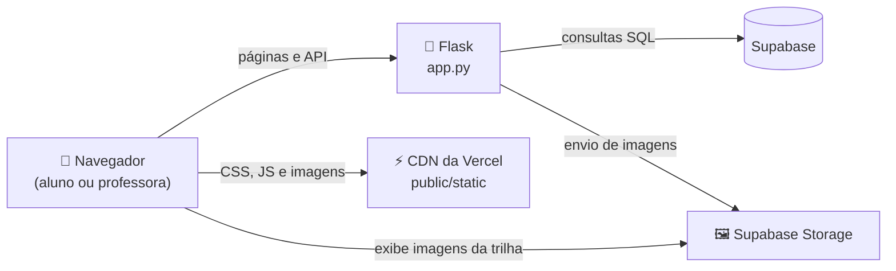

- O **navegador** carrega as páginas pelo Flask. Os arquivos fixos (CSS, JavaScript e imagens) vêm direto da CDN.
- O **Flask** é o único que conversa com o banco. Ele confere o login, valida as respostas e salva o progresso.
- As **imagens da trilha** são enviadas pelo servidor ao Supabase Storage, e os alunos as abrem pelo link público.
- A **Arena** funciona quase em tempo real: a tela de cada aluno e o acompanhamento da partida no painel da professora consultam o servidor a cada 3 segundos (a lista de arenas e a fila de ajuda, a cada 6 segundos).

---

## 💻 Como executar no seu computador

### O que você precisa ter instalado

| Programa | Onde baixar |
| --- | --- |
| Python 3.12 (ou mais novo) | [python.org/downloads](https://www.python.org/downloads/). Na instalação, marque **"Add Python to PATH"** |
| Git | [git-scm.com](https://git-scm.com/) |
| Conta no Supabase (gratuita) | [supabase.com](https://supabase.com/) |

> Os comandos abaixo são para o **PowerShell** do Windows. Abra o terminal **dentro da pasta do projeto**.

### Passo 1: baixar o projeto

```powershell
git clone https://github.com/ViniciusMarioziOliveira/TCC_RobooTeam.git
cd TCC_RobooTeam
```

### Passo 2: criar o banco de dados no Supabase

1. Entre em [supabase.com/dashboard](https://supabase.com/dashboard) e clique em **New project**.
2. Escolha a região **South America (São Paulo)** e crie uma senha para o banco. **Guarde essa senha.**
3. No menu lateral, abra o **SQL Editor**.
4. Copie todo o conteúdo do arquivo `supabase/schema.sql`, cole no editor e clique em **Run**. Isso cria as tabelas.
5. Faça o mesmo com o arquivo `supabase/professora_beatriz.sql`. Isso cria o login da professora.

### Passo 3: criar o ambiente virtual do Python

O ambiente virtual é uma pasta (`.venv`) que guarda as bibliotecas só deste projeto.

```powershell
py -m venv .venv
```

### Passo 4: instalar as bibliotecas

```powershell
.\.venv\Scripts\python.exe -m pip install -r requirements.txt
```

### Passo 5: configurar o arquivo `.env`

O `.env` guarda as senhas e chaves do projeto. Ele **nunca** vai para o GitHub.

1. Faça uma cópia do arquivo de exemplo:

   ```powershell
   Copy-Item .env.example .env
   ```

2. Abra o `.env` e preencha cada linha:

   | Variável | Onde encontrar |
   | --- | --- |
   | `SECRET_KEY` | Uma chave aleatória. Gere com o comando abaixo da tabela |
   | `DATABASE_URL` | Supabase → botão **Connect** → **Transaction pooler** (porta 6543). Troque `[YOUR-PASSWORD]` pela senha do Passo 2 |
   | `SUPABASE_URL` | Supabase → **Project Settings → API Keys** → URL do projeto |
   | `SUPABASE_SECRET_KEY` | Supabase → **Project Settings → API Keys** → **secret key** (começa com `sb_secret_`) |

   Para gerar a `SECRET_KEY`:

   ```powershell
   .\.venv\Scripts\python.exe -c "import secrets; print(secrets.token_hex(32))"
   ```

### Passo 6: iniciar o sistema

```powershell
.\.venv\Scripts\python.exe app.py
```

Quando aparecer `Running on http://127.0.0.1:5000`, o sistema está no ar.

### Passo 7: abrir no navegador

Acesse **http://127.0.0.1:5000**. Para desligar o servidor, volte ao terminal e aperte `Ctrl + C`.

> **Algo deu errado?**
> - *"Não foi possível acessar o banco de dados"*: confira a `DATABASE_URL` no `.env`. Ela deve ser a do **Transaction pooler** (porta 6543), com a senha correta.
> - *"O envio de imagens ainda não foi configurado"*: faltou preencher `SUPABASE_URL` ou `SUPABASE_SECRET_KEY`.
> - *`py` não é reconhecido*: reinstale o Python marcando **"Add Python to PATH"**.

---

## 🚀 Primeiro acesso

### Como professora

- **E-mail:** `beatriz@robooteam.com`
- **Senha:** entregue separadamente pela equipe (não fica no repositório).

No painel, clique em **Gerar novo código** para criar o código da sala (`RBT-XXXX`). Ele vale por 24 horas.

### Como aluno

1. Na página inicial, clique em **Cadastre-se**.
2. Preencha nome (de 3 a 100 caracteres), e-mail (até 254 caracteres) e senha (de 8 a 20 caracteres).
3. Entre com o e-mail e a senha cadastrados.
4. No painel, digite no campo **Código da turma** os 4 últimos caracteres do código que a professora gerou.

> Alunos **sem turma** veem a trilha padrão. Alunos **com turma** veem a trilha montada pela professora.

---

## 🔑 Trocar a senha da professora

O banco guarda apenas o **hash** da senha (uma versão embaralhada), nunca a senha em si. Para trocar:

**1. No terminal**, gere o hash da nova senha (troque `NOVA_SENHA` pela senha desejada):

```powershell
.\.venv\Scripts\python.exe -c "from werkzeug.security import generate_password_hash as h; print(h('NOVA_SENHA'))"
```

Copie o resultado inteiro (começa com `scrypt:`).

**2. No Supabase**, abra o **SQL Editor** e rode, colando o hash entre as aspas simples:

```sql
update public.usuarios set senha_hash = 'COLE_O_HASH_AQUI' where perfil = 'PROFESSOR';
```

Pronto: a próxima entrada já usa a senha nova.

---

## 🗄️ Banco de dados

As tabelas são criadas pelo arquivo `supabase/schema.sql`:

| Tabela | O que guarda |
| --- | --- |
| `usuarios` | Alunos e a professora (nome, e-mail, senha em hash, turma e código de sala) |
| `progresso_trilha` | Etapas da trilha concluídas por cada aluno |
| `progresso_jogo` | Fases da Missão Robô concluídas e a melhor pontuação |
| `trilha_atividades` | Trilha personalizada pela professora |
| `arenas` | Partidas da Arena (mapa, código e situação) |
| `arena_equipes` | Equipes de cada partida |
| `arena_jogadores` | Jogadores, tempos, tentativas, dicas, estrelas e pedidos de ajuda |

Também é criado o bucket público `trilha-imagens`, no Supabase Storage, para as imagens das etapas.

> O robô personalizado da Oficina fica salvo no navegador do aluno (`localStorage`), não no banco.

---

## 🔒 Segurança

- **Senhas** guardadas apenas como hash (algoritmo *scrypt*).
- **Login** por token assinado, guardado em cookie `HttpOnly` (o JavaScript da página não consegue lê-lo).
- **Um único professor**: o banco impede a criação de um segundo, e todo cadastro feito pelo site é de aluno.
- **RLS (Row Level Security)** ligado em todas as tabelas: só o servidor acessa os dados, e as chaves públicas do Supabase não leem nada.
- **Respostas conferidas no servidor**: quizzes, fases da Missão Robô e partidas da Arena são validados (e simulados de novo) pelo Flask, não pelo navegador.
- **Arena só para a turma**: apenas alunos da turma da professora que criou a partida conseguem entrar, jogar e pedir ajuda.
- **Imagens verificadas** pelo conteúdo do arquivo (PNG, JPG, WEBP ou GIF, até 4 MB), não apenas pela extensão.
- **Chaves e senhas** ficam no `.env` (fora do GitHub) ou nas variáveis de ambiente da hospedagem.

---

## 📁 Estrutura dos arquivos

```text
TCC_RobooTeam/
├── app.py                  # Aplicação Flask: páginas e API
├── db.py                   # Conexão com o banco do Supabase
├── usuarios_store.py       # Usuários, login e progresso dos alunos
├── trilha_store.py         # Trilha personalizada da professora
├── arena_store.py          # Partidas da Arena RobooTeam
├── armazenamento.py        # Imagens da trilha no Supabase Storage
├── trilha_conteudo.py      # Conteúdo padrão da trilha e dos minijogos
├── jogo_conteudo.py        # Fases e regras do jogo de blocos
│
├── templates/              # Páginas HTML
│   ├── _icones.html        # Ícones do site (sprite SVG, base Lucide)
│   ├── index.html          # Página inicial
│   ├── login.html          # Login e cadastro
│   ├── aluno.html          # Painel do aluno
│   ├── trilha_aula.html    # Conteúdo de uma etapa da trilha
│   ├── jogo_blocos.html    # Missão Robô (programação em blocos)
│   ├── arena.html          # Arena RobooTeam
│   └── professor.html      # Painel da professora
│
├── public/static/          # CSS, JavaScript e imagens
│   └── img/
│       ├── 1.png … 6.png   # Poses do robô (fundo transparente)
│       └── 1_variantes/ …  # A mesma pose com cada acessório (1_coroa.webp…);
│                           # 1_coroa_cor.webp guarda só o dourado/rosa, que não muda com a cor do robô
│
├── supabase/
│   ├── schema.sql              # Tabelas, segurança e bucket de imagens
│   └── professora_beatriz.sql  # Login da professora
│
├── docs/readme/            # Capturas de tela e GIFs deste README
├── .env.example            # Modelo das variáveis de ambiente
├── requirements.txt        # Bibliotecas Python
├── .python-version         # Versão do Python
└── vercel.json             # Configuração da hospedagem
```

---

## 📸 Sobre as imagens deste README

- A **página inicial** e a **tela de acesso** foram capturadas do site publicado em [tcc-roboo-team.vercel.app](https://tcc-roboo-team.vercel.app).
- As **telas internas** (aluno, professora e Arena) foram gravadas rodando **o mesmo código** do repositório, com um banco de dados temporário preenchido com **dados fictícios de demonstração** (alunos, turma e partidas). Nenhum dado real de usuários aparece nas imagens.
- A etapa bônus **"As peças de um robô"** foi criada pelo próprio editor da professora, só para demonstrar o minijogo **Ligar os blocos**.

---

## 👥 Equipe

<div align="center">

Projeto desenvolvido por **Ana Beatriz**, **Felipe Barros**, **Rebeca Diniz** e **Vinícius Mariozi** como Trabalho de Conclusão de Curso.


</div>
